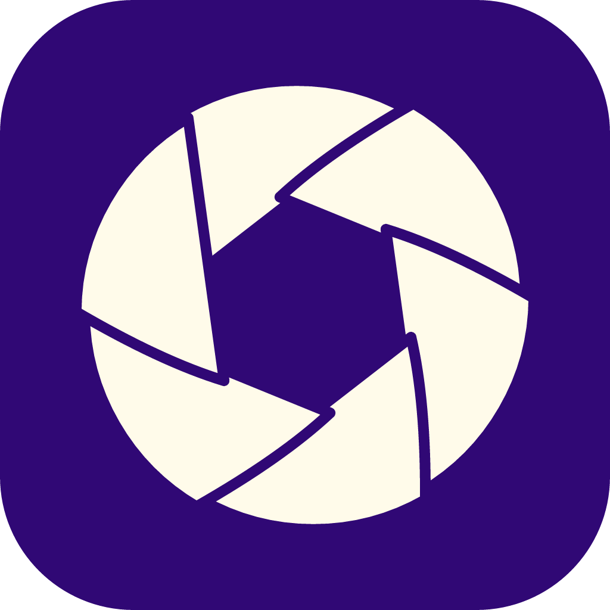
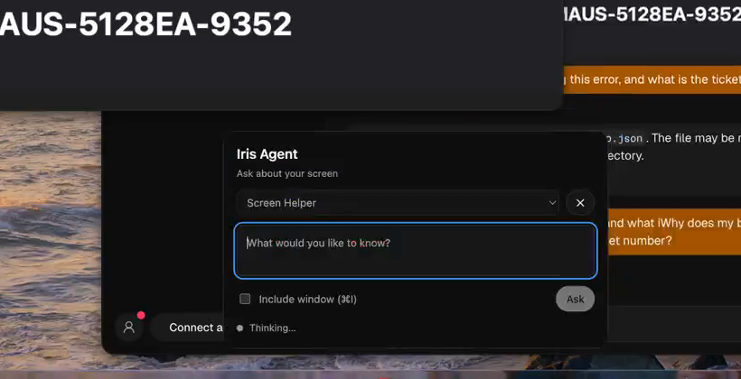
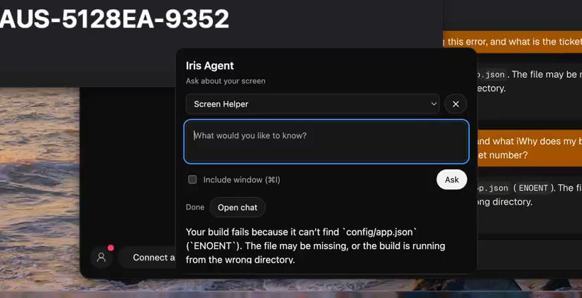
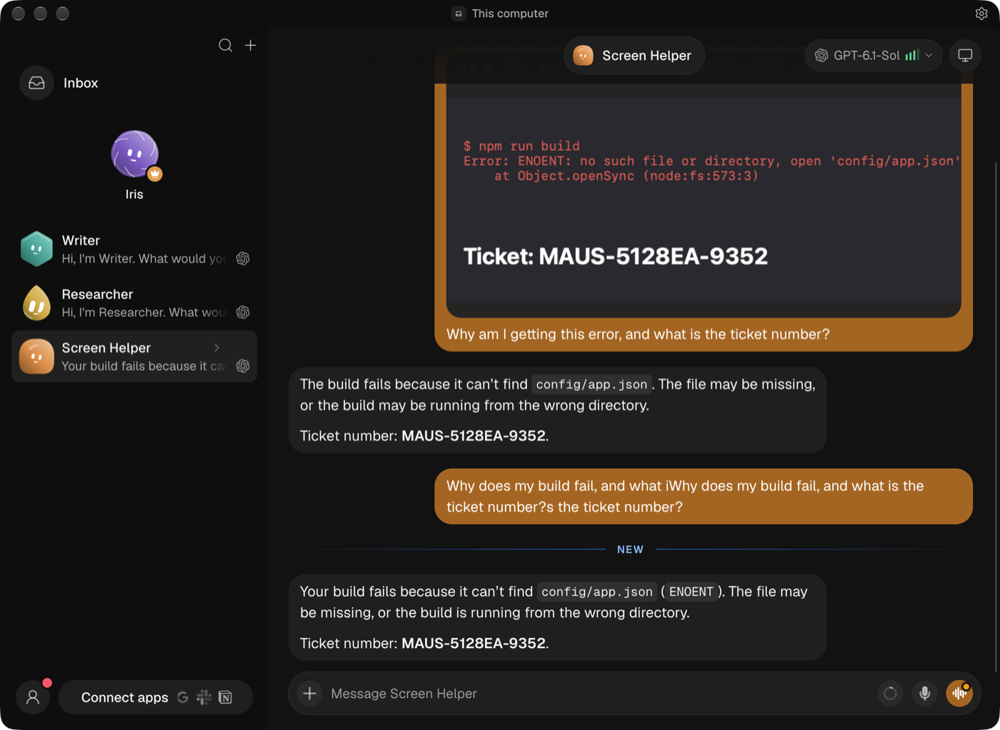
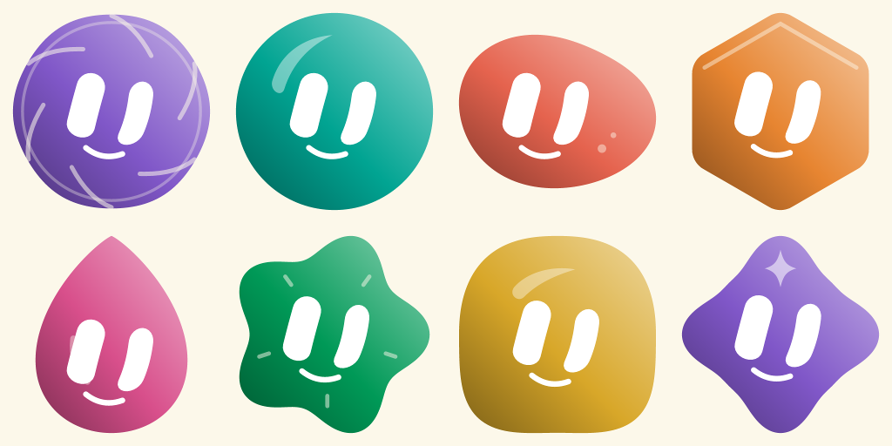

<div align="center">



# Iris Agent

**Ask your AI agents about whatever is on your screen.**
A local-first desktop app for running a small team of AI agents, with a system-wide Ask panel that can attach a screenshot of the window you were working in.

[Demo video](docs/media/iris-agent-demo.mp4) · [Architecture](docs/ask-panel/ARCHITECTURE.md) · [Privacy & security](docs/ask-panel/PRIVACY_AND_SECURITY.md) · [Test plan](docs/ask-panel/TEST_PLAN.md)

</div>

---

## Overview

Iris Agent runs on your own computer. Each agent ("bot") has its own conversation history, model, permissions and memory, and runs through the official command-line tools of the AI providers you already use (for example the Codex CLI signed in with your ChatGPT plan). Iris Agent never asks for a separately billed API key, and there is no hosted backend or database.

The defining feature is the **Ask panel**:

1. Working in any app, press **⌃⌥A** (Control + Option + A).
2. A small panel opens over your work. Pick an agent and type a question.
3. Press **⌘I** to include a window. The window you were just using is preselected; you see a preview before anything is sent.
4. The question and screenshot go to that agent's *Quick asks* conversation. The answer streams into the panel.
5. Press **Esc**. The panel hides and your previous app comes back to the front. The full conversation stays in Iris Agent.

Agents keep the approval rules you gave them: if an answer would require running a command, the panel shows **Needs you · Open chat** instead of acting.

## Screenshots

| Ask panel with a window attached | Answer streamed into the panel |
|---|---|
|  |  |



Every agent gets its own character, chosen per agent and stable across launches:



## Demo

A one-minute walkthrough (welcome screen, characters, asking about a build error in another window, the streamed answer, and the conversation in the full app):

https://github.com/RealCloudyPanda/mausbot-companion/raw/companion/docs/media/iris-agent-demo.mp4

## Features

- **System-wide Ask panel**: global shortcut, bot picker, text-only or screenshot questions, streamed replies, Esc to return to your work. Also available from the app menu, the macOS Dock menu and the Windows tray.
- **Explicit, previewed capture**: nothing is captured until you turn on *Include window*; a cancelled capture never touches disk; images are downscaled to a 2000 px long edge.
- **Previous-window detection** on macOS through a small native helper, with a window picker as fallback on every platform.
- **Multiple agents**, each with its own model, history, memory and approval level, inherited from the upstream runtime.
- **No duplicate notifications**: while the panel shows an answer, its "finished" banner is held back; approvals, questions, failures and spend warnings always show.
- **Own data folder**: the packaged app keeps everything in `~/.iris-agent`, so it never shares data with another installation.
- **Low idle cost**: the panel window is created on first use and nothing polls. Measured idle cost on an Apple M1 dev build: 0.42 % mean CPU, 170 MB RSS across all Electron processes (single run; see the [test plan](docs/ask-panel/TEST_PLAN.md)).

## Getting started

Requirements: macOS (primary target), Node.js 24, pnpm via Corepack, and at least one supported provider CLI signed in with your own account (the demo uses the Codex CLI signed in with ChatGPT).

```bash
git clone https://github.com/RealCloudyPanda/mausbot-companion.git iris-agent
cd iris-agent
corepack pnpm install --frozen-lockfile
```

Run in development (three terminals; development data lives in `~/.openmausbot-dev`, separate from any installed app):

```bash
corepack pnpm dev:server
```

```bash
corepack pnpm dev
```

```bash
corepack pnpm dev:desktop
```

Build an unsigned local macOS app (`release/mac-arm64/iris.app`):

```bash
corepack pnpm package:mac
```

On 8 GB machines, give the build more memory with `NODE_OPTIONS=--max-old-space-size=5120`.

**Permissions.** The first time you press ⌘I, macOS asks for Screen Recording permission. Grant it in System Settings → Privacy & Security → Screen & System Audio Recording, then restart the app. Text-only questions work without it.

A step-by-step demo and a troubleshooting runbook are in [docs/ask-panel/DEMO_SCRIPT.md](docs/ask-panel/DEMO_SCRIPT.md).

## Privacy

Iris Agent is local-first, which is not the same as offline. When you send a screenshot, it is stored with the conversation on your computer **and sent to the AI provider of the agent you chose**. The provider's CLI may also keep its own session log. Deleting a conversation removes its messages, logs and attachments; memory entries stay until the agent is deleted. Details, with file references: [PRIVACY_AND_SECURITY.md](docs/ask-panel/PRIVACY_AND_SECURITY.md).

## Architecture and quality

| | |
|---|---|
| Processes | Electron main process (all privileged work), a sandboxed Ask panel renderer with a narrow preload API, the local agent server, provider CLI subprocesses, and a native macOS helper |
| Security | The server's owner capability is attached below page JavaScript and never reaches the panel; IPC handlers reject other senders and validate input |
| Tests | 2,239 Electron unit tests and the project's Vitest suites; CI on macOS, Ubuntu and Windows via `.github/workflows/ask-panel-ci.yml` |
| Docs | [Architecture](docs/ask-panel/ARCHITECTURE.md) · [Protocols & APIs](docs/ask-panel/PROTOCOLS_AND_APIS.md) · [Decisions](docs/ask-panel/DECISIONS.md) · [CI/CD](docs/ask-panel/CI_CD.md) · [Repository map](docs/ask-panel/REPO_MAP.md) |

## Known limitations

- macOS is the primary platform. Windows and Linux builds pass CI but have not been measured on real hardware; previous-window detection is macOS-only.
- Builds are unsigned and not notarized; Intel Macs get the window picker without previous-window detection.
- Screenshot questions currently require an agent running on an image-capable engine (Codex in the demo).

## Credits and licensing

Iris Agent is a fork of **[OpenMausBot](https://github.com/milind-soni/OpenMausBot)** by Milind Soni and contributors, licensed under the Apache License 2.0. The agent runtime, server, conversations, approvals, notifications and most of the desktop shell come from that project. This fork was taken at upstream commit `c175749a` (v0.1.169). The original `LICENSE` and `NOTICE` files are kept unchanged, and the upstream source-available `enterprise/` directory has been removed so this repository is Apache-2.0 only.

Added in this fork: the Ask panel and its main-process bridge, previous-window detection, focus return, Ask menu entries, notification suppression, development and packaged data isolation, the Iris Agent name, icon and characters (all original, drawn in code), CI for three platforms, and the documentation in `docs/ask-panel/`.

Inspiration only (no code, UI, prompts or assets were copied):

- [Jayu](https://www.jonathanouyang.com/projects/jayu) by Jonathan Ouyang and [Gemini Computer Use](https://github.com/JonOuyang/Gemini-Computer-Use): screen-aware desktop assistant ideas.
- [Natively](https://github.com/Natively-AI-assistant/natively-cluely-ai-assistant): floating assistant overlay pattern. Its source is under a personal-use license, so nothing from it is included.
- [Matt Pocock's skills](https://github.com/mattpocock/skills) (`grill-with-docs`, `domain-modeling`): the planning method used to record decisions.

Built with [Electron](https://www.electronjs.org/), [React](https://react.dev/), [Vite](https://vite.dev/) and [Vitest](https://vitest.dev/). Third-party notices for bundled dependencies are in `NOTICE` and `third_party/`.

Iris Agent is an independent project. It is not affiliated with or endorsed by OpenMausBot, OpenAI, Anthropic or any other provider; product names belong to their owners.

Licensed under the [Apache License 2.0](LICENSE).
