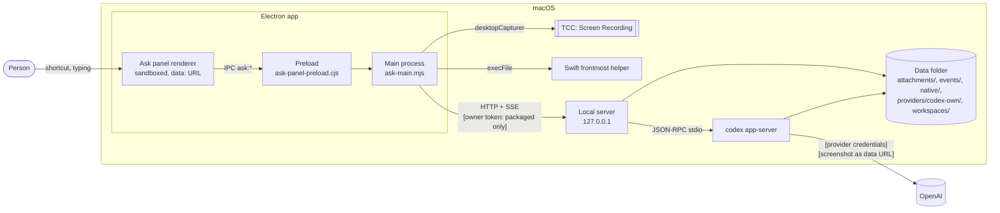
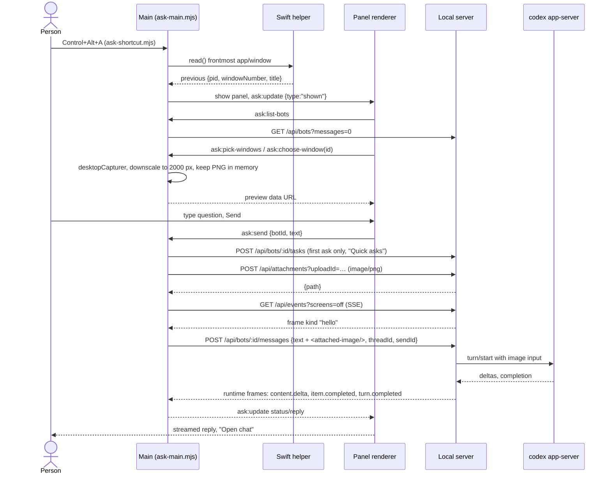

# Ask panel: architecture

Facts below come from code on `companion`; paths are cited. Upstream parts are described only as far as the Ask
panel uses them.

## Processes

| Process | What it is | Source |
|---|---|---|
| Electron main | Registers the shortcut, owns the panel window, captures windows, talks to the local server | `electron/main.mjs` (`installAsk`, ~line 2941), `electron/ask-main.mjs` |
| Ask panel renderer | `type: "panel"` window, `sandbox: true`, `contextIsolation: true`, `nodeIntegration: false`, page loaded from a `data:` URL; navigation and new windows denied | `electron/ask-panel.mjs` (`createAskPanel`) |
| Ask panel preload | Exposes `window.ask` (9 calls + `onUpdate`) and nothing else | `electron/ask-panel-preload.cjs` |
| Local server | MausBot's Node server: bots, threads, attachments, SSE events. Packaged: spawned by main on `127.0.0.1:<SERVER_PORT>`; dev: `pnpm dev:server` | `electron/main.mjs:2581` (`localServerRequest`), `server/dev-server.ts` |
| `codex app-server` | Codex CLI subprocess the server drives for a bot on the `codex` instance | `server/drivers/codex.ts`, `server/drivers/codex-images.ts` |
| Swift frontmost helper | Short-lived binary: frontmost app (pid, bundle id, name), its front window number and title, and window-number to app-name pairs; also re-activates a pid | `electron/frontmost-window.swift`, `electron/frontmost-window.mjs` (300 ms timeout) |
| macOS TCC | Screen Recording permission gates `desktopCapturer` and window titles | `electron/ask-capture.mjs` (`getMediaAccessStatus("screen")`) |

## Container view

Trust and data marks:
- **[screenshot]** lives in main-process memory until Send (`electron/ask-capture.mjs` header comment; `held` in
  `electron/ask-main.mjs`), then is uploaded as a PNG, stored by the server and sent to OpenAI by Codex. The renderer
  only gets a downscaled preview data URL.
- **[owner token]** `desktopMutationToken` is added as a header by `localServerRequest` in packaged builds only
  (`electron/main.mjs:2581`, `electron/desktop-server-auth.cjs`). In dev, main uses plain `fetch` to `DEV_URL`
  (`electron/main.mjs:2941`) and the dev server trusts local browsers (`server/dev-server.ts:6`).
- **[provider credentials]** ChatGPT sign-in stays with the server and Codex under `providers/` in the data folder;
  the panel and main's Ask code never see them.

## Sequence: one ask with a window

Order detail: the SSE stream is opened first and the message is POSTed only after the `hello` frame
(`electron/talk-server.mjs`, `ask()`), so no reply frame is missed.

## Focus and notifications

- Esc or Send hides the panel; focus returns to the recorded pid only when the panel itself hides
  (`installAsk` `onHide`, `electron/ask-main.mjs`).
- `askPanel.suppresses(threadId)` is passed to `installDesktopNotifications` as `suppressed`
  (`electron/main.mjs:2619`); only the `"done"` banner of the displayed thread is held back
  (`electron/desktop-notifications.mjs:73`).
- Remote desktop access disables the Ask panel entirely (`if (!desktopRemoteAccess)`, `electron/main.mjs:2941`).
